# AVA Uridium

[](https://github.com/Harlock123/AVAUridium/actions/workflows/build.yml)

A fast, fluid shooter in the style of Graftgold's 1986 Commodore 64 game **Uridium**, built with .NET 10 and
Avalonia UI. Eight dreadnoughts are stripping the moons of the Lyra system. Fly the fighter **Shrike** low over
each one's deck at speed, weaving through the gaps in its towering superstructure. Shoot its fuel pods, land on
its strip, and set its reactor running wild.

## Features

- **The Shrike flies like a fighter:** it speeds up the way it faces, keeps its speed, and coasts. Pull back
  against your speed to slow down; slow enough, and it loops up and over to face the other way.
  - **Up or down rolls the ship onto its side,** thin enough for the narrowest gaps. A tap rolls it without
    moving it, and the roll holds for a moment after you let go.
- **Eight dreadnoughts,** each longer, more heavily walled and better defended than the last:
  **Basalt**, **Quartz**, **Jasper**, **Garnet**, **Obsidian**, **Beryl**, **Onyx** and **Topaz**. Fences of
  superstructure cross the whole deck, with gaps to find. On later dreadnoughts some gaps are so tight that
  only a rolled ship gets through cleanly.
- **On the deck:** fuel pods to shoot, guns that fire at the ship, and ports that let out homing mines. The
  ship flies over all of them.
- **Waves of fighters,** five at a time, from ahead or behind:
  - **darts** that edge toward the ship's height;
  - **saucers** that weave;
  - **swoopers** that dive;
  - **chasers** that hunt.

  Shoot a whole wave down for a bonus.
- **Land now:** shoot every fuel pod, or hold out long enough, and the order comes to land on the strip at
  the tail, slow and level. Then **the reactor**: its lights go round, and each press of fire stops them on a
  prize, three times. Then the dreadnought blows up from end to end.
- **The scanner** shows the whole dreadnought: its fences, its pods, the strip, where you are, and the part on
  the screen.
- **The ship's computer speaks:** "Dreadnought ahead", "Land now", "Dreadnought destroyed". The voice comes
  from a small formant synthesiser in the build tools, so no recording or speech engine is needed.
- **Original music:** a bright flying tune in E minor over rippling arpeggios, a title theme and jingles.
- **The attract mode** shows the computer pilot at work. It maps how far every square of the deck is from
  where it wants to be, round the walls, and follows that map. It lines up on pods, rolls through tight
  gaps, and slows onto the strip. Every few steps it tries each way to steer on copies of the world, and
  keeps to its plan only if that's safe.

## Screenshots

| The title | Over the deck | A pod shot |
|:---------:|:-------------:|:----------:|
| 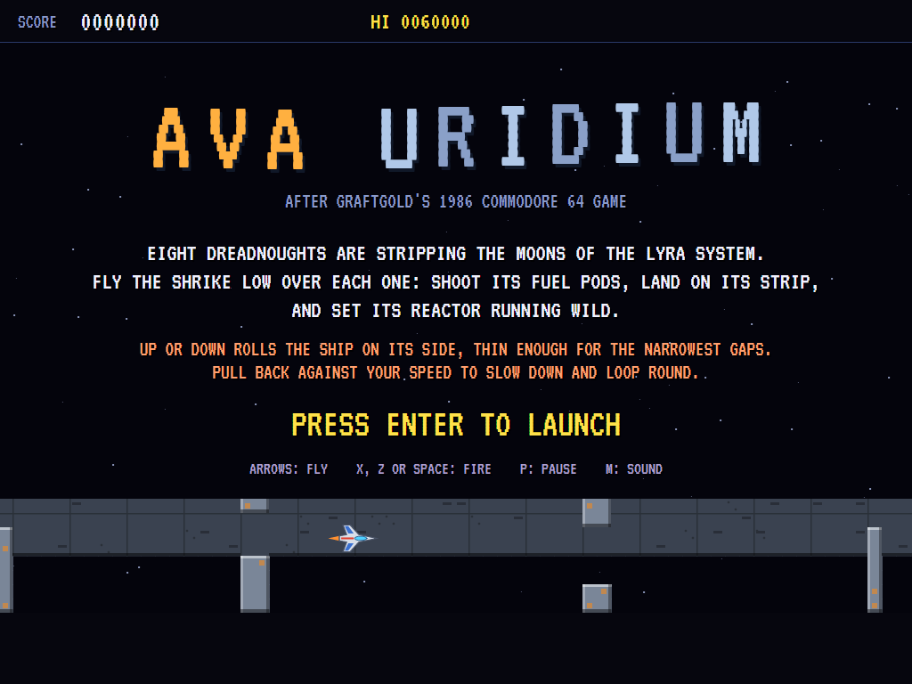 | 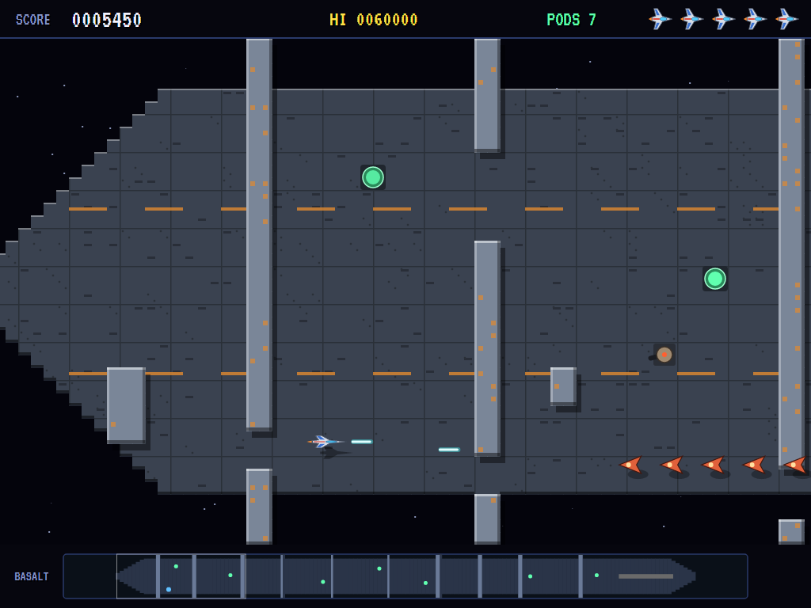 | 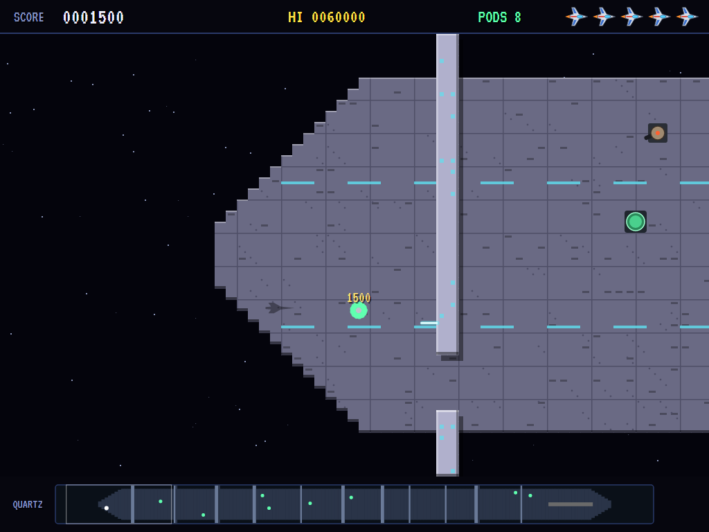 |
| The Shrike over a dreadnought. | Basalt: fences, pods, saucers. | Quartz: a fuel pod goes up. |

| A wave | Through a gap | A loop |
|:------:|:-------------:|:------:|
| 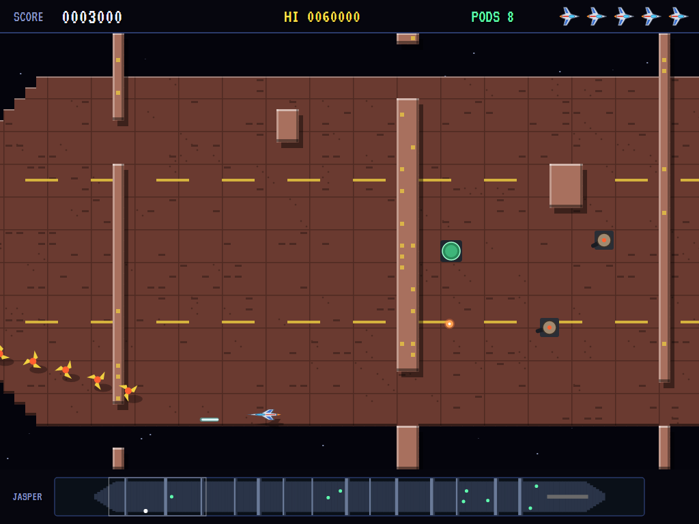 | 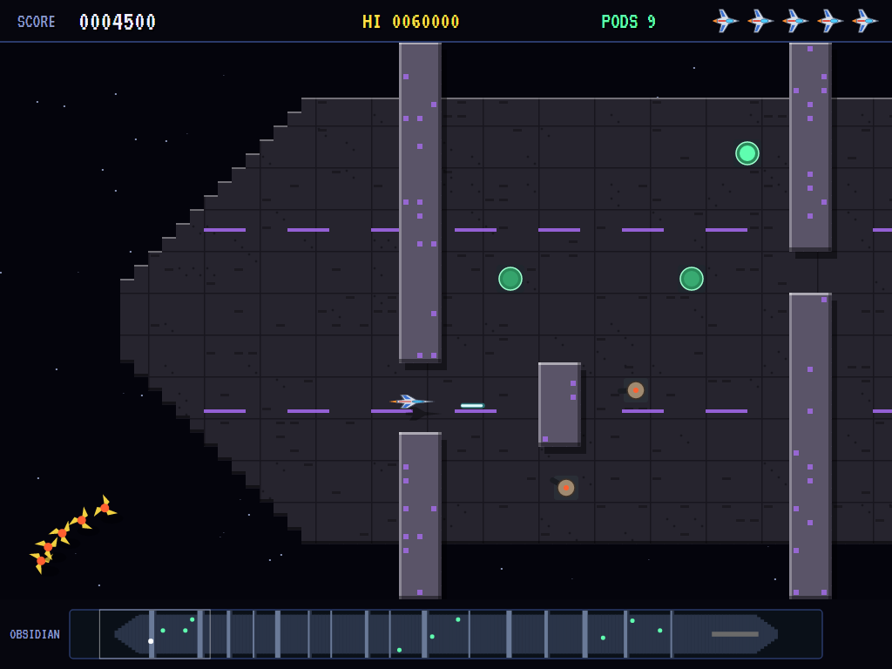 | 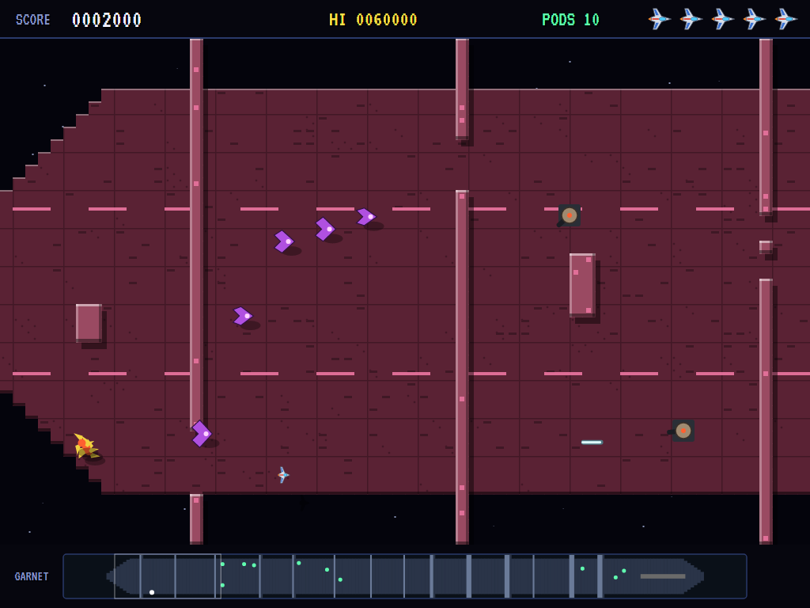 |
| Jasper: chasers coming. | Obsidian: on its side through a fence. | Garnet: turning about. |

| Mines | Land now | The reactor |
|:-----:|:--------:|:-----------:|
| 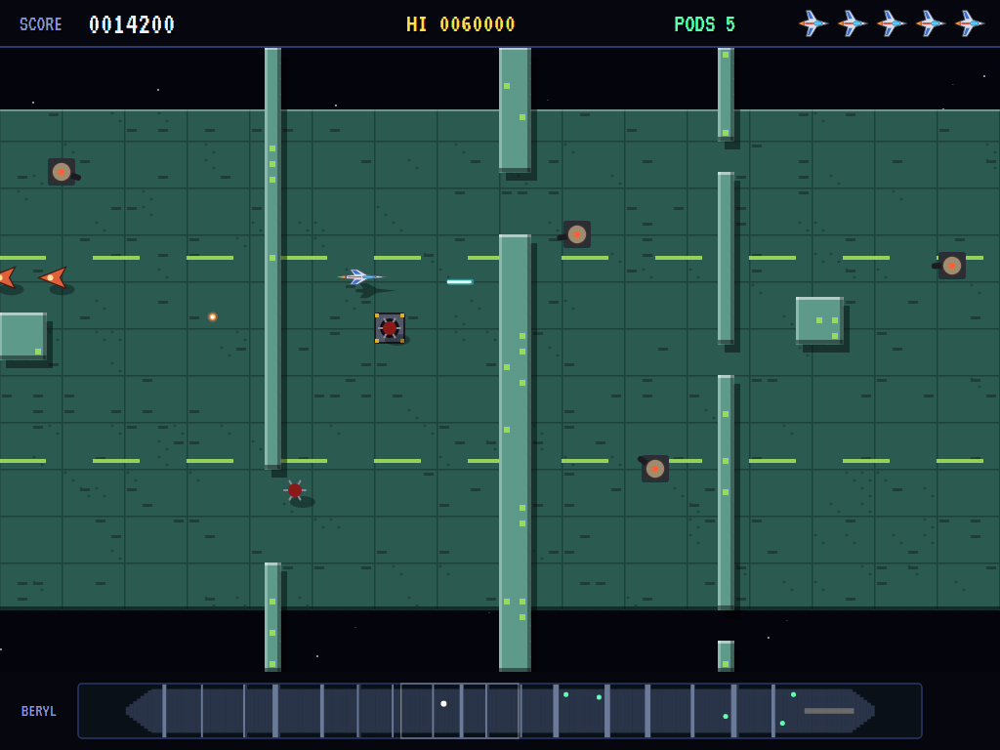 | 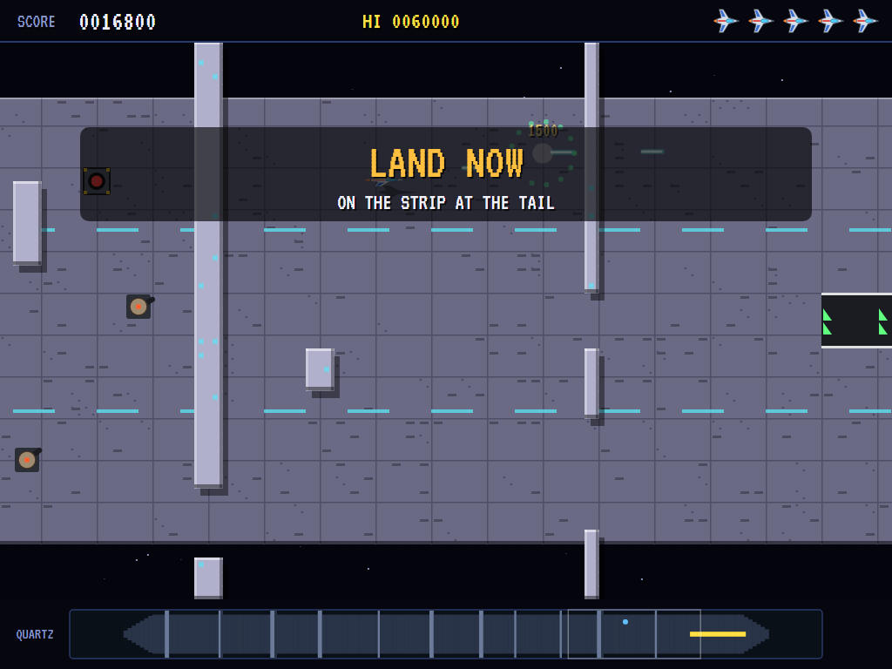 | 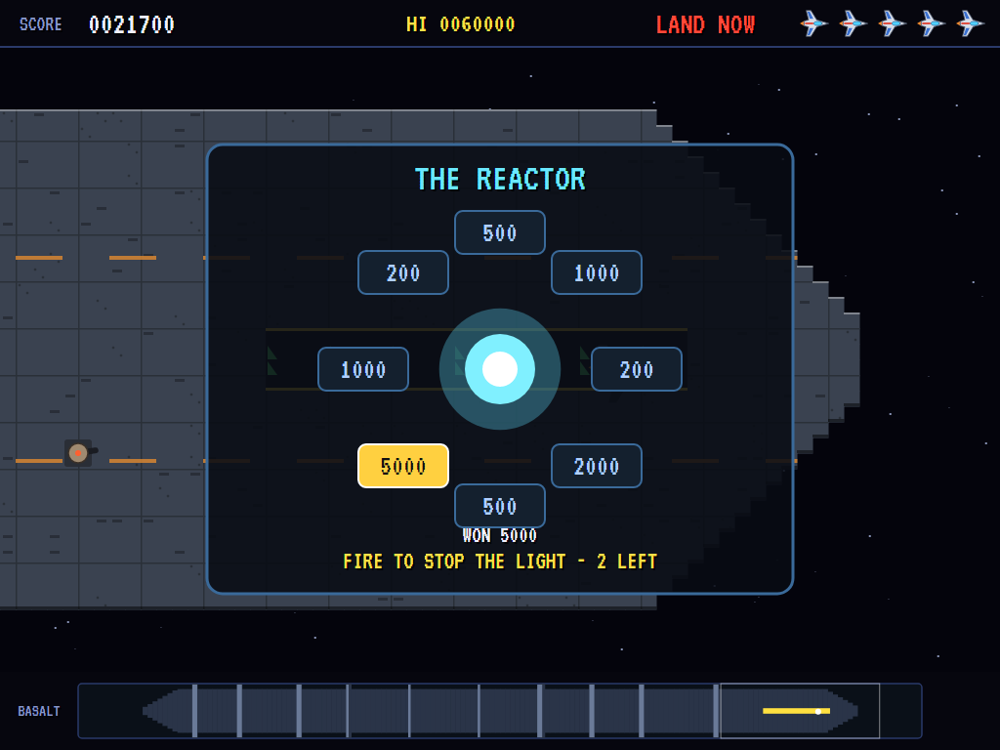 |
| Beryl: mines from the ports. | The order comes. | Stop the lights on a prize. |

| Destroyed | Topaz | The top pilots |
|:---------:|:-----:|:--------------:|
| 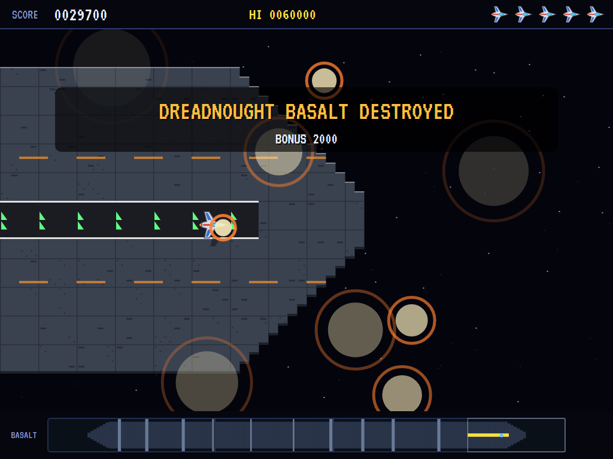 | 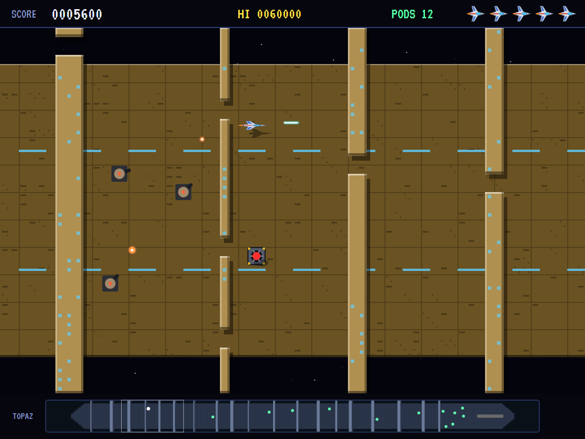 | 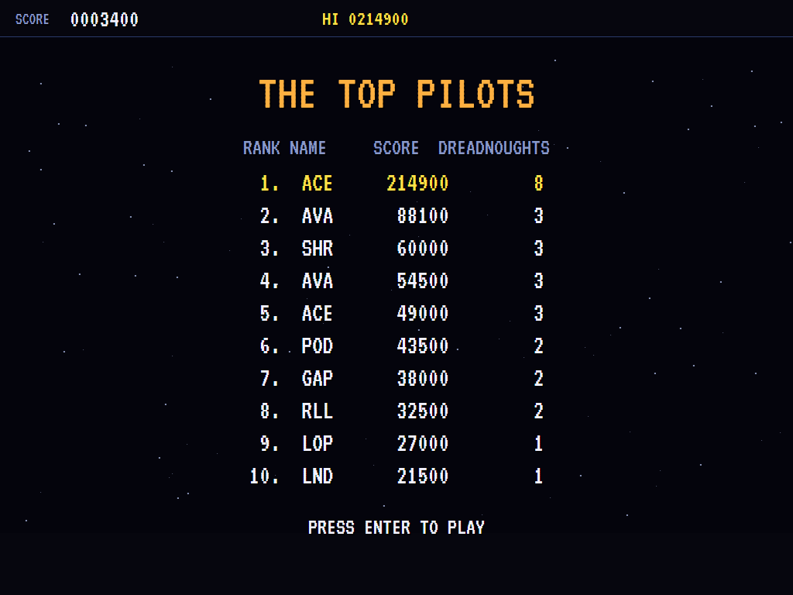 |
| The dreadnought goes up. | The last dreadnought. | The high-score table. |

The screenshots are made by the tests, which play the game in a real (headless) window; see
[Tests](#tests).

## Download and run

Ready-to-run builds for Windows, macOS and Linux, on both Intel/AMD and ARM, are on the
[Releases page](https://github.com/Harlock123/AVAUridium/releases/tag/latest). **Latest build** is
rebuilt on every push to `main`. Each download is one self-contained executable: no .NET install is
needed.

| Platform | Archive |
|---|---|
| Windows | `AVAUridium-win-x64.zip`, `AVAUridium-win-x86.zip`, `AVAUridium-win-arm64.zip` |
| macOS | `AVAUridium-osx-arm64.tar.gz` (Apple silicon), `AVAUridium-osx-x64.tar.gz` (Intel) |
| Linux | `AVAUridium-linux-x64.tar.gz`, `AVAUridium-linux-arm64.tar.gz`, `AVAUridium-linux-arm.tar.gz` |

```bash
tar -xzf AVAUridium-linux-x64.tar.gz     # or linux-arm64, linux-arm, osx-arm64, osx-x64
./AVAUridium
```

On Windows, unzip and run `AVAUridium.exe`. On macOS, if Gatekeeper refuses to open it, run
`xattr -d com.apple.quarantine AVAUridium` once. Run with `--no-audio` for silence.

**Sound** comes through OpenAL Soft, built in for every platform. In a virtual machine the game
detects it and uses a larger audio buffer, so the sound doesn't break up.

**Gamepads** use SDL2, which is bundled for Windows, macOS and Intel/AMD Linux. ARM Linux builds need it
installed; without it the keyboard still works:

```bash
sudo apt install libsdl2-dev            # Debian / Ubuntu / Raspberry Pi OS
sudo pacman -S --needed sdl2-compat     # Arch / Omarchy
```

## Controls

| Action | Keyboard | Gamepad |
|---|---|---|
| Start | Enter or 1 | Start |
| Fly faster (the way you face) | Left/right arrows or A/D | Left stick / D-pad |
| Slow down, and loop round | Against the way you face | Against the way you face |
| Up and down, and roll | Up/down arrows or W/S (a tap just rolls) | Up/down |
| Fire (hold) | X, Z, Space, Ctrl or Shift | A, B, X or right trigger |
| Pause | P or Esc | Start or Back |
| Sound on/off | M | |
| Screenshot | Ctrl+S (to your Pictures folder) | |

On the high-score table, type your initials, or use up/down and Space, then Enter.

## Tests

```bash
dotnet test AVAUridium.slnx
```

The game runs in fixed 60 Hz steps, so it plays the same at any frame rate. Everything that moves lives in
one world that can be copied, and a copy plays out exactly as the world does (that's tested too). The tests
check:

- **The dreadnoughts:** a rolled ship can reach every pod and the strip on every one; the first two can be
  flown without rolling, and later ones can't; each is longer and better defended, with fences and a clear
  strip. The computer pilot destroys every dreadnought.
- **Flying:** speeding up and coasting; pulling back, then the loop on the spot; rolling, and the roll
  holding; taps rolling without moving; a tower is deadly; rolled, the ship slips through a narrow gap that
  stops it level.
- **Shooting:** three shots at a time the way the ship faces; a pod takes three shots; every pod shot (or
  the time run out) brings the order to land; a whole wave is a bonus.
- **The defences:** fighters and mines are deadly, but the ship flies over what stands on the deck; ports
  let out mines that hunt the ship; waves of five come in from the edges.
- **Landing:** slow and level over the strip it lands; too fast it doesn't; without the order the strip is
  just deck; then the reactor's three stops, the prize won, and on to the next dreadnought.
- **The game:** a lost ship comes back further back along the deck, with what was shot still shot; the last
  ship and the high-score table; the demonstration and the high scores; the keys.

`tests/AVAUridium.Tests/PilotProbe.cs` reports how the computer pilot gets on over each dreadnought, for
tuning (`URIDIUM_PROBE=1`; `URIDIUM_PROBE=lazy` for a pilot who only flies on along the middle, firing).

The screenshot tests draw the real screen in a headless window. To refresh the README's pictures:

```bash
URIDIUM_SHOTS=$PWD/Images dotnet test tests/AVAUridium.Tests --filter ScreenshotTests
```

## Building

```bash
dotnet build AVAUridium.slnx
dotnet run --project src/AVAUridium
```

Needs the .NET 10 SDK. The sounds, the voice and the tunes are made by `tools/make_sounds.py`
(standard-library Python, with `tools/speech.py` for the voice): `python3 tools/make_sounds.py` rewrites
`src/AVAUridium/Sounds`.

## Project structure

```
AVAUridium/
├── AVAUridium.slnx
├── src/AVAUridium/
│   ├── Engine/
│   │   ├── GameEngine.cs        # States, lives, dreadnoughts in turn, the reactor, the title and demonstration
│   │   ├── Sim.cs               # A run step by step: flying, rolling and looping, shots, the defences, landing
│   │   ├── World.cs             # Everything that moves, kept together so it can be copied
│   │   ├── Stage.cs             # Squares, and how the eight dreadnoughts are built
│   │   ├── Pilot.cs             # The computer pilot (the demonstration, and the tests)
│   │   ├── HighScoreTable.cs, InitialsEntry.cs
│   │   ├── InputHandler.cs, ControllerManager.cs  # Keys and an SDL2 gamepad
│   │   └── SoundManager.cs      # Effects, the voice and the music through OpenAL
│   ├── Audio/                   # The OpenAL engine (from the author's AVABand)
│   ├── Views/                   # The drawing: the decks, the towers, the Shrike, the scanner and the reactor
│   └── Sounds/                  # The synthesised effects, voice and tunes
├── tests/AVAUridium.Tests/      # Dreadnought, gameplay and screenshot tests
├── tools/make_sounds.py, tools/speech.py
└── Images/                      # Screenshots
```

## About and licence

AVA Uridium © 2026 Lonnie Watson, under the [MIT License](LICENSE).

*Uridium* © 1986 Hewson Consultants, written by Andrew Braybrook of Graftgold; the name belongs to its current
owner. AVA Uridium is an independent, unofficial game in its style. Its ship, dreadnoughts, enemies and
reactor, its graphics, sounds, voice, tunes and code are its own; nothing is taken from the original game's
program, graphics or sound. It is not affiliated with or endorsed by any rights holder.
